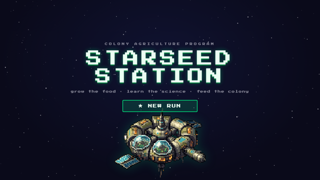
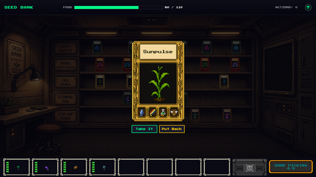
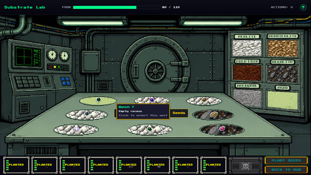
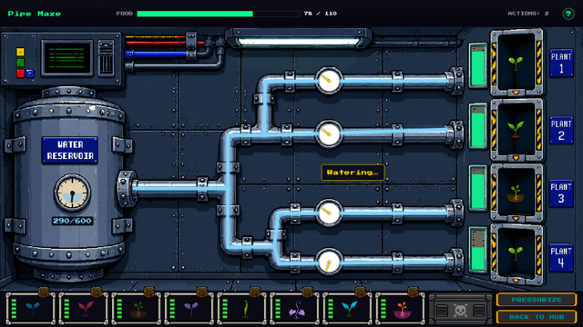
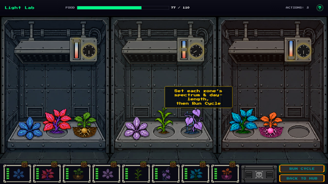
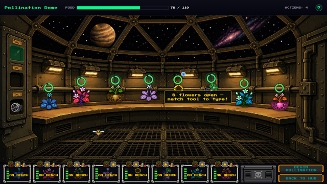
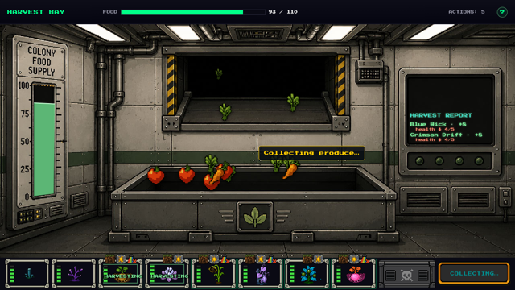
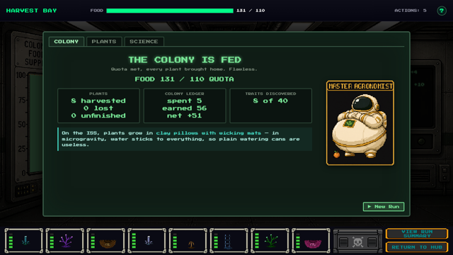
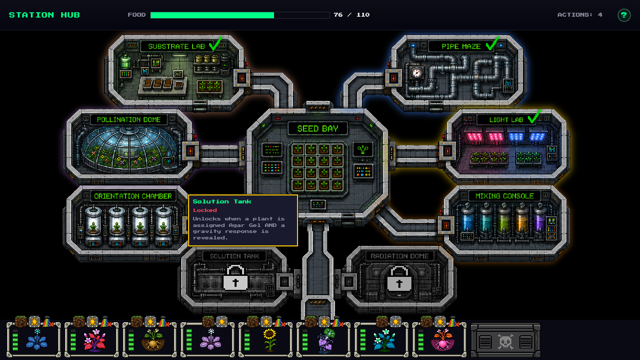

  

<h1 align="center">STARSEED STATION</h1>

<em>Grow the food. Learn the science. Feed the colony.</em>

  <a href="https://interstellarharvest.github.io/starseed-station/"><b>▶ PLAY IN YOUR BROWSER</b></a> 
  No install, no account. Desktop browser recommended. Your progress saves automatically. 
  Prefer offline? Download the repo and open <code>index.html</code>.

---

You are the newest agronomist aboard an orbital farming station, and the colony is hungry.
Eight seed packets, eight science rooms, one harvest season. Every room is a hands-on puzzle
built on a real growing concept, and every plant hides traits you can only uncover by
experimenting. Get it right and the colony eats. Get it wrong and the autopsy card tells you
exactly why.

Starseed Station is a browser-based science game in the spirit of
*The Logical Journey of the Zoombinis*: no lectures, no quizzes, just rooms that teach by
letting you try things.

## Pick your crew

Twenty space-adapted crops sit on the shelves of the Seed Bank, from cherry tomato and dwarf
wheat to watercress and cantaloupe. Each packet shows what you can know up front: water
need, light preference, appetite, how it pollinates. The rest, like how it feels about
gravity, pH, radiation and the length of the day, stays a question mark until you test it.
Choose eight.

## Eight rooms, eight lessons

**Substrate Lab.** Space farms cannot haul soil from Earth. Match each seed to a growing
medium, from perlite and coco coir to crushed regolith and nutrient gel, and find out which
plants are fussy about their roots.

**Pipe Maze.** One tank of recycled water for the whole season. Dial each plant's supply,
pressurize the lines and watch the gauges grade you. Drought and flood both hurt, and every
drop you waste is gone for good.

**Light Lab.** Plants eat light, but not all colours equally. Sort your crops into three
zones, tune each zone's spectrum and day-length, and discover which plants will only flower
when the hours are right.

**Mixing Console.** Fertiliser chemistry with three dials: nitrogen, phosphorus, potassium.
Feed each plant to its appetite and its stage of growth. Too little starves it. Too much
burns it.

**Orientation Chamber.** In orbit there is no down. Rotate each plant until its shoot points
the right way and learn which species can cope without gravity and which cannot.

**Solution Tank.** Hydroponics without a safety net. Nudge pH and nutrient strength on two
live channels and keep the solution inside the band where roots can actually feed.

**Radiation Dome.** Deep space is hostile. Shield your bays with aluminium, polyethylene,
regolith or plain water, run the exposure, and find out which material really stops a
particle storm.

**Pollination Dome.** The station's only real-time room. No bees, no breeze, just you with a
pollen brush, a Bee-Bot and an air circulator while every bloom's timer runs down. Match the
tool to the flower before it closes.

## Bring in the harvest

Ripe crops roll down the chute and the colony's food meter climbs. Yield follows the plant's
whole story: its health, whether it was pollinated, whether it got the light it needed. A
plant you neglected gives back less. A plant you lost gives back nothing.

At the end of the season the debrief shows where the food came from, where things went
wrong room by room, and the science behind each mistake. Earn your rank, from Hungry Winter
to Master Agronomist, then start a new run and do it better.

## Three postings

- **Cadet** — a first posting. Generous rations and a curated seed rack.
- **Commander** — the standard run.
- **Specialist** — deep space. Tight rations, a higher quota, and the Radiation Dome online.

## Made for the classroom

Every death comes with an autopsy card and a short, middle-school-level explanation of the
plant science involved. Hover anything for a tooltip. A built-in tour walks first-time
players through each room, and the whole game runs from a single folder with nothing to
install, so it works on a locked-down lab machine as well as it does at home.

---

Built as an educational science game. 🛰

